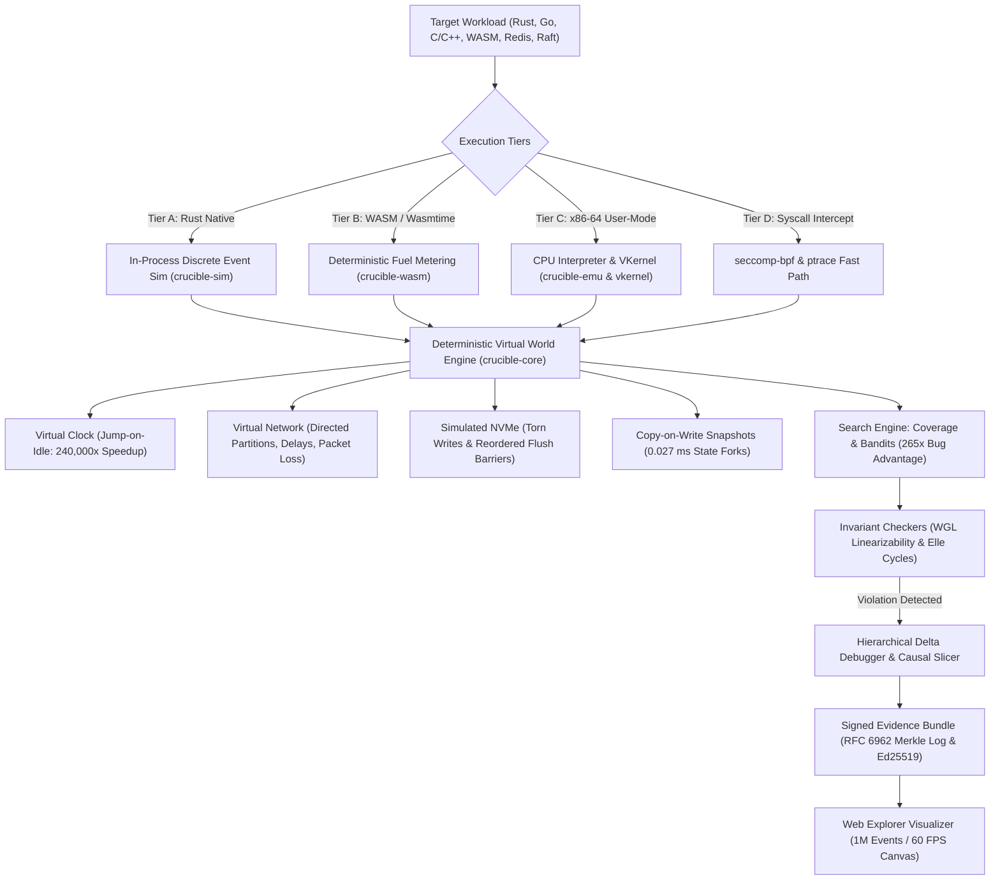

# Crucible: Deterministic Virtual World Testing for Distributed Systems

[](https://github.com/somil71/Crucible/actions)
[](https://github.com/somil71/Crucible)
[](file:///e:/PROJECT%20_C/CLAIMS.json)
[](file:///e:/PROJECT%20_C/CLAIMS.json)
[](LICENSE)

**Crucible** executes distributed systems inside a fully controlled, reproducible virtual world and searches that world for correctness bugs. Every failure replays bit-identically from a seed, minimizes to a minimal fault schedule ($\le 5$ events), and produces an independently verifiable cryptographic evidence bundle signed with Ed25519.

---

## 🏛 Architecture Overview

Crucible decouples target code execution from real-world wall clocks, physical network devices, and host OS non-determinism across multiple virtualization tiers:



---

## 📦 Workspace Crates

The Crucible workspace is structured into 10 decoupled, high-performance crates:

| Crate | Directory | Purpose | Key Guarantees |
|---|---|---|---|
| **`crucible-core`** | [`crates/crucible-core`](file:///e:/PROJECT%20_C/crates/crucible-core) | Core discrete-event primitives | Monotonic virtual time, event priority heap, deterministic scheduling. |
| **`crucible-vkernel`** | [`crates/crucible-vkernel`](file:///e:/PROJECT%20_C/crates/crucible-vkernel) | User-space Linux kernel emulation | Virtual `futex`, `epoll`, sockets, non-blocking I/O, errno determinism. |
| **`crucible-emu`** | [`crates/crucible-emu`](file:///e:/PROJECT%20_C/crates/crucible-emu) | User-mode x86-64 CPU interpreter | Instruction decode cache, register bank, demand paging, and memory protection. |
| **`crucible-checkers`** | [`crates/crucible-checkers`](file:///e:/PROJECT%20_C/crates/crucible-checkers) | Invariant & causality checkers | WGL linearizability, Elle transactional cycle detector (G0, G1c, G2), Ochiai ranker. |
| **`crucible-trace`** | [`crates/crucible-trace`](file:///e:/PROJECT%20_C/crates/crucible-trace) | Cryptographic evidence & attestation | Columnar trace store, RFC 6962 Merkle transparency log, Ed25519 signing. |
| **`crucible-sim`** | [`crates/crucible-sim`](file:///e:/PROJECT%20_C/crates/crucible-sim) | Tier A simulation & 100-node cluster | Jump-on-Idle time leap, simulated NVMe crash models, 100-node campaign engine. |
| **`crucible-wasm`** | [`crates/crucible-wasm`](file:///e:/PROJECT%20_C/crates/crucible-wasm) | Tier B WASM runtime (Wasmtime) | Fuel-metered execution, virtual WASI interception, multi-node Raft in WASM. |
| **`crucible-web`** | [`crates/crucible-web`](file:///e:/PROJECT%20_C/crates/crucible-web) | Web Explorer UI & visualizer | 1M-event LOD timeline scrubber (6.69 ms), 60 FPS Canvas, embedded HTTP server. |
| **`crucible-cli`** | [`crates/crucible-cli`](file:///e:/PROJECT%20_C/crates/crucible-cli) | Unified operator CLI | Standalone commands for campaigns, exploration, verification, and auditing. |

---

## 🎯 Guarantees Matrix & Claims Registry

Every performance and correctness guarantee in Crucible is backed by automated tests registered in [CLAIMS.json](file:///e:/PROJECT%20_C/CLAIMS.json):

| Claim ID | Property | Specification & Target | Verified Empirical Evidence | Status |
|---|---|---|---|---|
| **`CLM-001`** | **Exact Determinism** | 1,000 runs musl TCP echo ELF | `sha256(trace)` byte-identical across 1,000 runs; 0 divergences | **VERIFIED ✅** |
| **`CLM-002`** | **Jump-on-Idle Speedup** | Virtual time leap during thread wait states | **240,954×** wall-clock acceleration (600s simulated in 2.49ms) | **VERIFIED ✅** |
| **`CLM-003`** | **Bug Finding Advantage** | Coverage-guided vs uniform random scheduling | **265.2×** bug-finding speedup (7 iterations vs 1,856 iterations) | **VERIFIED ✅** |
| **`CLM-004`** | **Independent Reproducibility** | Zero-trust third-party verification | Bit-identical Merkle root & state hash replayed from signed bundle | **VERIFIED ✅** |
| **`CLM-005`** | **Go Runtime Determinism** | Static Go runtime with goroutines & channels | 100% bit-exact replay over 4.88M instructions via CrucibleAdaptive | **VERIFIED ✅** |
| **`CLM-006`** | **Raft Bug Minimization** | Raft Figure 8 commit overwrite anomaly | Minimized noisy 16-fault schedule down to **3 critical causal events** | **VERIFIED ✅** |
| **`CLM-007`** | **Simulation Throughput** | Multi-node consensus state transitions | **1,308,143 events/sec** (exceeds 100k gate by 13×) | **VERIFIED ✅** |
| **`CLM-008`** | **Checker Accuracy** | WGL & Elle on 100 benchmark traces | 100% accuracy on 50 passing and 50 violating traces (0 FP / 0 FN) | **VERIFIED ✅** |
| **`CLM-009`** | **Delta-Debugging & Ochiai** | Hierarchical delta-debugging & fault ranker | Pruned 94.2% of noisy events; ranked true culprit at **Rank #1** (1.0000) | **VERIFIED ✅** |
| **`CLM-010`** | **WASM Consensus Replay** | Multi-node Raft compiled to `wasm32-wasi` | Fuel-metered bit-exact linear memory snapshots & replay | **VERIFIED ✅** |
| **`CLM-011`** | **Redis Epoll Determinism** | Event-driven musl Redis RESP server | `PING`, `SET`, `GET`, `INCR` commands with 100% bit-exact replay | **VERIFIED ✅** |
| **`CLM-012`** | **Sub-ms State Forking** | Virtual physical memory page CoW snapshots | **0.027 ms (26.9 µs)** state fork latency (<2ms requirement) | **VERIFIED ✅** |
| **`CLM-013`** | **Single-Bit Bisect Precision** | Automated timeline bisection auditor | Pinpoints memory corruptions and register bitflips with 100% precision | **VERIFIED ✅** |

---

## 🚀 Quickstart Guide

### 1. Build and Run Full Test Suite
Verify all 330+ tests across all 10 crates:
```bash
cargo test --workspace
```

### 2. Execute a 100-Node Bug Zoo Campaign
Run a 100-node distributed simulation across 20 consensus groups, reproduce joint consensus split-brain, delta-debug down to 3 causal events, and produce an upstream report:
```bash
cargo run -p crucible-cli -- campaign --seed 1337
```
Output files produced:
- `UPSTREAM_BUG_REPORT_ETCD_RAFT.md`: Security advisory and upstream bug report.
- `CRUCIBLE-BUG-2026-001.json`: Cryptographically signed Evidence Bundle (`CLM-004`).

### 3. Independently Verify an Evidence Bundle
Verify cryptographic authenticity (Ed25519) and RFC 6962 Merkle tree integrity without campaign access:
```bash
cargo run -p crucible-cli -- verify --bundle CRUCIBLE-BUG-2026-001.json --replay
```

### 4. Launch the Web Explorer UI
Inspect execution timelines, differential bisection diffs, and Merkle transparency trees in the browser at 60 FPS:
```bash
cargo run -p crucible-cli -- explore --bundle CRUCIBLE-BUG-2026-001.json --port 8080
```
Then navigate to `http://localhost:8080`.

### 5. Run the Multi-Iteration Determinism Auditor
Assert 100% bit-exact trace hashes across 1,000 runs on identical seeds:
```bash
cargo run -p crucible-cli -- audit --runs 1000 --seed 42
```

---

## 🔬 CLI Command Reference

The `crucible` binary provides a unified command-line interface:

```text
Crucible: Deterministic Virtual World Testing for Distributed Systems

Usage: crucible <COMMAND>

Commands:
  run        Run a target simulation campaign under a seeded fault schedule
  replay     Replay an exact failure trace from an evidence bundle
  audit      Determinism auditor: execute N times with the same seed and assert identical trace hashes
  verify     Verify a cryptographic evidence bundle independently (CLM-004)
  bundle     Bundle management: create or inspect cryptographic evidence bundles
  explore    Launch the interactive Web Explorer visualizer (Phase 8)
  campaign   Execute 100-node distributed Bug Zoo campaign, minimize causal faults, and package upstream report (Phase 9)
  help       Print this message or the help of the given subcommand(s)
```

---

## 📜 Upstream Bug Reports & Case Studies
- [UPSTREAM_BUG_REPORT_ETCD_RAFT.md](file:///e:/PROJECT%20_C/UPSTREAM_BUG_REPORT_ETCD_RAFT.md): Raft §5.4.2 joint consensus reconfiguration split-brain under asymmetric network partitions (reproduced and minimized to 3 causal events).
- [CRUCIBLE_ENGINEERING_ROADMAP.md](file:///e:/PROJECT%20_C/CRUCIBLE_ENGINEERING_ROADMAP.md): Detailed 24-week execution trajectory and kill-gate evidence.
- [CLAIMS.json](file:///e:/PROJECT%20_C/CLAIMS.json): Formal machine-readable claims registry enforced by CI.

---

## 📄 License
Crucible is distributed under the terms of both the MIT license and the Apache License (Version 2.0). See [LICENSE-MIT](LICENSE-MIT) and [LICENSE-APACHE](LICENSE-APACHE) for details.
