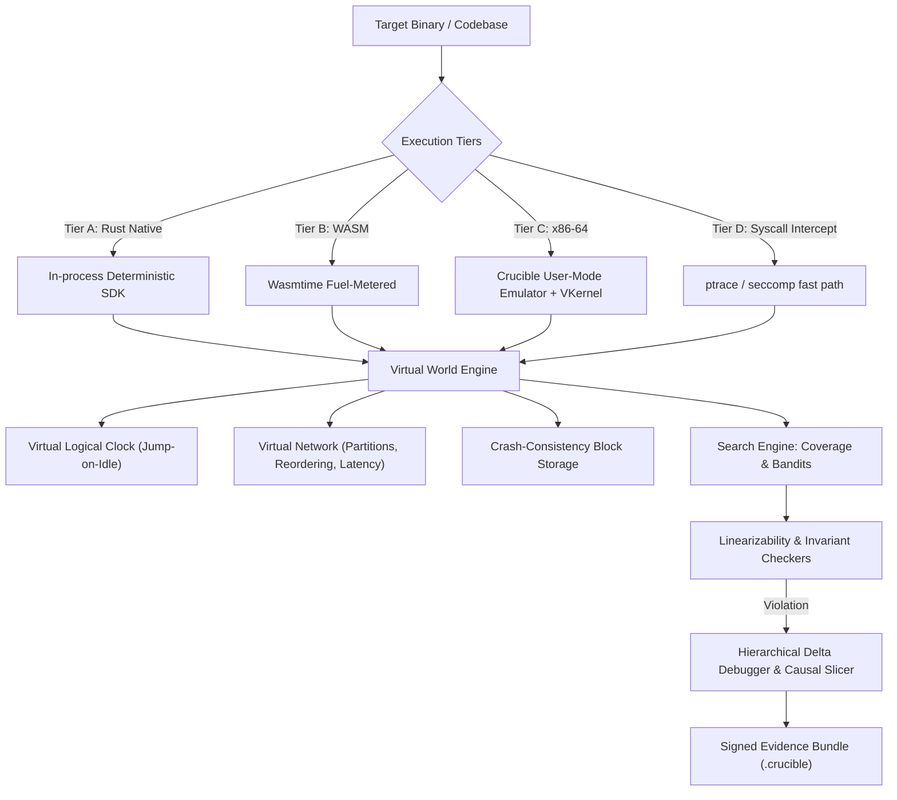

# Crucible

**Deterministic Virtual World Testing for Distributed Systems**

Crucible runs distributed systems inside a fully controlled, reproducible virtual world and searches that world for correctness bugs. Every failure replays bit-identically from a seed, minimizes to a minimal fault schedule, and produces an independently verifiable cryptographic evidence bundle.

---

## Architecture Overview



## Guarantees Matrix

| Tier | Engine Target | Determinism Guarantee | Speed vs Native | Suitable Targets |
|---|---|---|---|---|
| **Tier A** | Rust Native SDK (`crucible-sim`) | **Exact (Bit-Identical)** | $\approx 10\times$ faster (jump-on-idle) | Rust distributed protocols, custom consensus engines |
| **Tier B** | WASM / Wasmtime (`crucible-wasm`) | **Exact (Fuel-Metered)** | $1\times - 3\times$ slower | Rust/C/Go compiled to WASM |
| **Tier C** | x86-64 DBT + V-Kernel (`crucible-emu`) | **Exact (Instruction-Stepped)** | $10\times - 50\times$ slower | Unmodified static Linux binaries (musl, Go, glibc) |
| **Tier D** | Syscall Interception (`seccomp`/`ptrace`) | **Best-Effort (Statistical)** | $1.2\times - 2\times$ slower | Fast broad search, legacy systems, multi-process |
| **Tier E** | KVM Micro-VM (Optional Linux) | **Coarse Determinism** | $2\times - 5\times$ slower | Unmodified kernels, proprietary drivers |

See [CLAIMS.json](file:///e:/PROJECT%20_C/CLAIMS.json) for the strict public claims registry.

---

## Workspace Structure

- `crates/crucible-core`: Deterministic world primitives, virtual clock, event priority queue, fault DSL.
- `crates/crucible-vkernel`: User-space Linux kernel emulation (futex, epoll, socket, time virtualization).
- `crates/crucible-emu`: User-mode x86-64 execution engine with exact instruction counting.
- `crates/crucible-checkers`: Linearizability (WGL), serializability cycle detection (Elle-style), invariant checkers.
- `crates/crucible-trace`: Columnar trace storage, Merkle audit log, and Ed25519 cryptographic evidence bundles.
- `crates/crucible-cli`: CLI for running campaigns, replaying bundles, and the determinism auditor.
- `specs/tla`: Formal TLA+ specification of the deterministic scheduler and virtual time advance.

---

## Quickstart

### Running the determinism audit
```bash
cargo run --bin crucible -- audit --runs 1000 --seed 42
```

### Running workspace tests
```bash
cargo test
```
